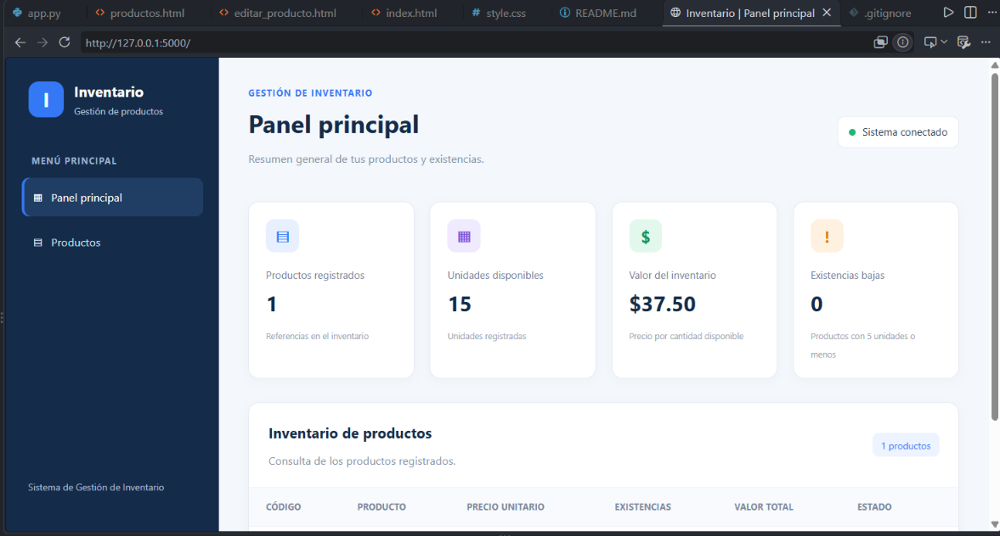
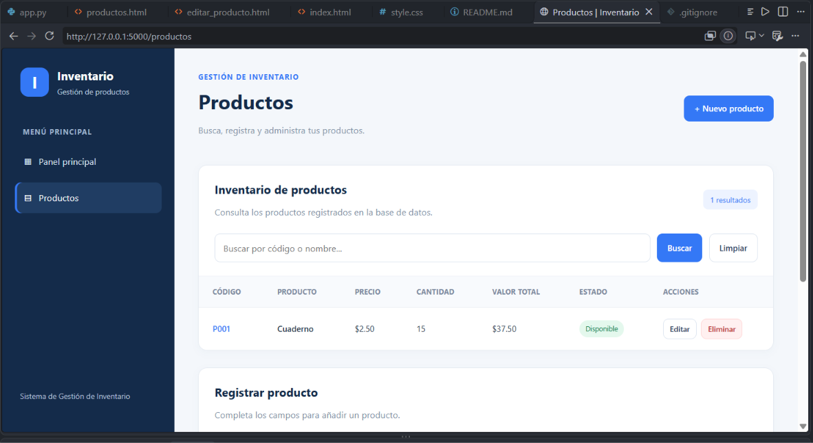
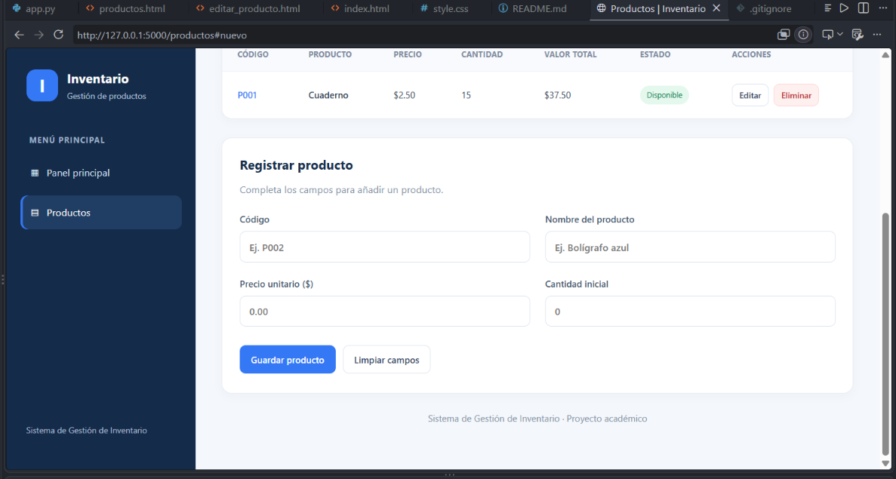
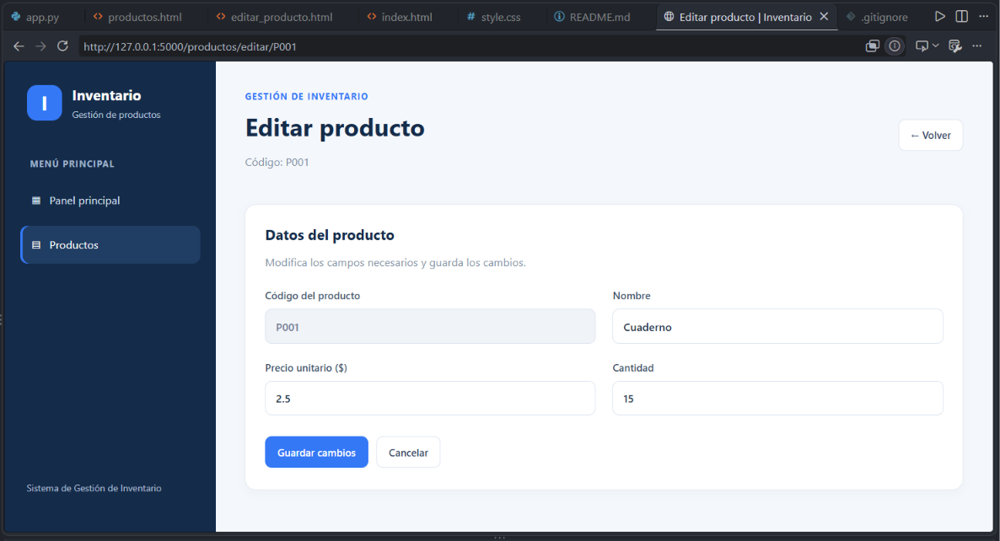

# Sistema de Gestión de Inventario

Proyecto académico desarrollado en Python para la asignatura Sistemas Colaborativos de la Universidad Tecnológica de Panamá. Forma parte de la construcción de un portafolio profesional digital orientado al desarrollo de soluciones informáticas.

## 1. Descripción del proyecto

El Sistema de Gestión de Inventario es una aplicación que permite registrar, consultar y administrar productos, controlar sus existencias y calcular el valor del inventario.

El proyecto cuenta con una versión inicial de consola y una versión web desarrollada con Flask. La aplicación web utiliza HTML para estructurar las páginas, CSS para el diseño visual y SQLite para almacenar la información.

## 2. Problema que resuelve

El sistema facilita el control básico de productos, precios y cantidades disponibles. Permite consultar los registros, identificar productos con pocas existencias y detectar productos agotados.

También incorpora validaciones para evitar códigos duplicados, precios negativos y cantidades negativas.

## 3. Objetivos

### Objetivo general

Desarrollar una aplicación de gestión de inventario que permita registrar, consultar y administrar productos mediante una interfaz web conectada a una base de datos SQLite.

### Objetivos específicos

- Registrar productos con código, nombre, precio y cantidad.
- Consultar y buscar productos por código o nombre.
- Modificar los datos y las existencias de productos registrados.
- Eliminar productos mediante una acción de confirmación.
- Calcular el valor de las existencias y mostrar alertas de inventario.
- Documentar el proyecto como parte de un portafolio profesional digital.

## 4. Tecnologías utilizadas

- **Python:** lenguaje de programación.
- **Flask:** framework utilizado para desarrollar la aplicación web.
- **SQLite:** sistema de base de datos relacional.
- **HTML5:** estructura de las páginas web.
- **CSS3:** diseño visual de la interfaz.
- **Visual Studio Code:** entorno de desarrollo.
- **Git y GitHub:** control de versiones y alojamiento del código fuente.

## 5. Funcionalidades

### 5.1. Panel principal

- Mostrar la cantidad de productos registrados.
- Calcular el total de unidades disponibles.
- Calcular el valor total del inventario.
- Mostrar la cantidad de productos con existencias bajas.

### 5.2. Gestión de productos

- Registrar productos nuevos.
- Consultar los productos almacenados.
- Buscar productos por código o nombre.
- Editar el nombre, el precio y la cantidad de un producto.
- Eliminar productos con confirmación.
- Mostrar el estado de las existencias: disponible, existencias bajas o agotado.

### 5.3. Validaciones

- Rechazar códigos duplicados.
- Impedir precios negativos.
- Impedir cantidades negativas.
- Informar cuando una búsqueda no devuelve resultados.
- Validar los datos introducidos en los formularios.

## 6. Estructura del proyecto

```text
Sistema Inventario/
├── .gitignore
├── app.py
├── main.py
├── README.md
├── requirements.txt
├── static/
│   └── style.css
└── templates/
    ├── index.html
    ├── productos.html
    └── editar_producto.html
```

### Descripción de los archivos principales

- `app.py`: contiene las rutas y la lógica de la aplicación web.
- `main.py`: contiene la versión inicial de consola.
- `README.md`: documenta el propósito, las funciones y el uso del proyecto.
- `requirements.txt`: especifica las dependencias de Python.
- `.gitignore`: excluye archivos locales y temporales del seguimiento de Git.
- `templates/index.html`: contiene el panel principal.
- `templates/productos.html`: permite buscar, registrar y administrar productos.
- `templates/editar_producto.html`: contiene el formulario de edición.
- `static/style.css`: define los estilos visuales de la aplicación.

La base de datos `inventario.db` se utiliza localmente y está excluida del repositorio mediante `.gitignore`.

## 7. Requisitos

Para ejecutar la aplicación se necesita:

- Python 3 instalado.
- Las dependencias indicadas en `requirements.txt`.
- Un navegador web actualizado.
- Los archivos del proyecto.

SQLite está disponible mediante la biblioteca estándar de Python y no requiere instalar un servidor de base de datos independiente.

## 8. Instalación y ejecución

### 8.1. Obtener el proyecto

Clona el repositorio o descarga sus archivos desde GitHub y abre la carpeta del proyecto en Visual Studio Code.

### 8.2. Instalar las dependencias

Abre una terminal en la carpeta del proyecto y ejecuta:

```bash
python -m pip install -r requirements.txt
```

### 8.3. Ejecutar la aplicación web

Ejecuta el siguiente comando:

```bash
python app.py
```

Cuando Flask indique que el servidor está activo, abre el navegador y visita:

```text
http://127.0.0.1:5000
```

Esta dirección corresponde al servidor local de desarrollo. La terminal debe permanecer abierta mientras se utiliza la aplicación.

### 8.4. Ejecutar la versión de consola

La versión inicial puede ejecutarse mediante:

```bash
python main.py
```

## 9. Base de datos

La aplicación utiliza SQLite para almacenar los productos. Cada registro contiene los siguientes campos:

| Campo | Descripción |
|---|---|
| `codigo` | Identificador único del producto. |
| `nombre` | Nombre del producto. |
| `precio` | Precio unitario. |
| `cantidad` | Número de unidades disponibles. |

La tabla establece restricciones para evitar códigos duplicados, precios negativos y cantidades negativas.

La aplicación web crea la tabla si todavía no existe. La base de datos se mantiene en el entorno local y no forma parte de los archivos publicados en GitHub.

## 10. Pruebas funcionales realizadas

Durante el desarrollo se realizaron pruebas manuales en el entorno local para comprobar:

- La visualización del panel principal y la lectura de los datos de SQLite.
- El registro de un producto de prueba.
- La búsqueda por código y nombre.
- La respuesta ante búsquedas sin resultados.
- La edición de los datos de un producto.
- La eliminación de un producto de prueba.
- La identificación de productos con existencias bajas.
- La identificación de productos agotados.
- La actualización de los indicadores del panel principal.

Estas comprobaciones corresponden a pruebas manuales realizadas durante el desarrollo. No constituyen una certificación integral del sistema ni sustituyen las pruebas automatizadas.

## 11. Capturas de pantalla y evidencias

## 11. Capturas de pantalla y evidencias

A continuación, se presentan capturas auténticas de la aplicación web Sistema de Gestión de Inventario, desarrollada con Python, Flask, HTML, CSS y SQLite.

### 11.1. Panel principal

El panel principal presenta un resumen de los productos registrados, las unidades disponibles, el valor total del inventario y las existencias bajas.



### 11.2. Gestión de productos

Esta pantalla permite consultar los productos registrados, buscar por código o nombre y acceder a las opciones de edición y eliminación.



### 11.3. Registro de productos

El formulario permite introducir el código, nombre, precio unitario y cantidad inicial de un producto.



### 11.4. Edición de productos

Esta pantalla permite modificar los datos de un producto registrado y guardar los cambios.



Las imágenes documentan las interfaces desarrolladas durante el proyecto. Las alertas de existencias bajas y productos agotados se documentarán por separado cuando se incorpore una captura específica de esos estados.

## 12. Seguridad y limitaciones

Esta versión se desarrolló con fines académicos y se ejecuta localmente. Antes de utilizarla en un entorno real, es necesario revisar la configuración de seguridad de Flask, la protección de las operaciones que modifican datos, el manejo de errores y las condiciones de despliegue.

El servidor de desarrollo de Flask no está destinado a producción. El proyecto requiere una revisión integral y pruebas adicionales antes de considerarse terminado.

## 13. Estado del proyecto

**Estado: en desarrollo.**

Se ha implementado una primera interfaz web conectada a SQLite y se han probado manualmente las funciones principales de gestión de productos. Quedan pendientes la revisión integral del código, la incorporación de capturas auténticas, la verificación de las instrucciones de instalación y las mejoras necesarias antes de un posible despliegue público.

## 14. Autor

**Bernabé Quijada Abrego**

Estudiante de la Universidad Tecnológica de Panamá.

Proyecto académico de la asignatura Sistemas Colaborativos.